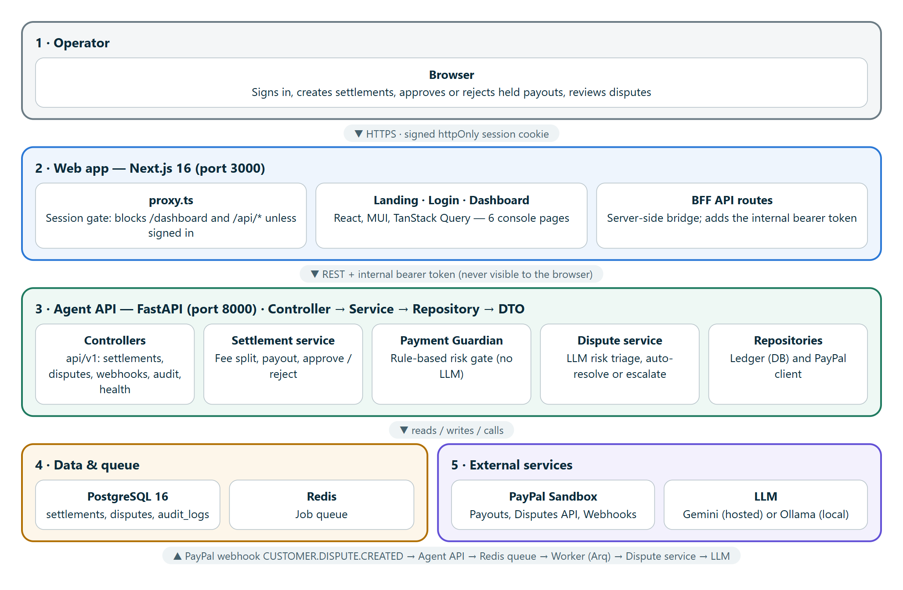
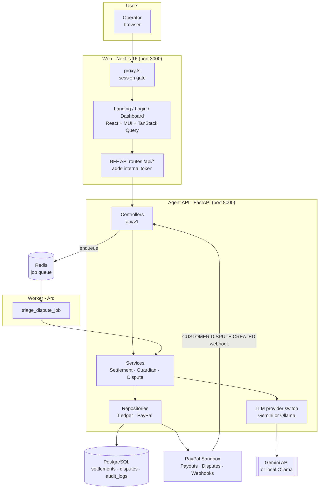
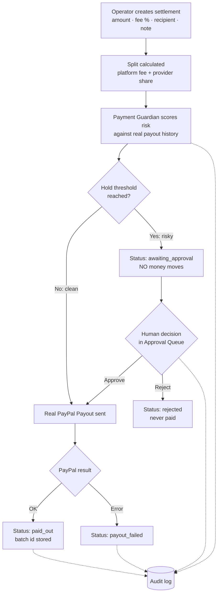
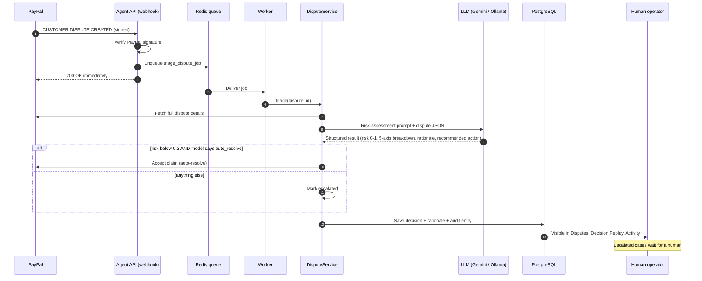
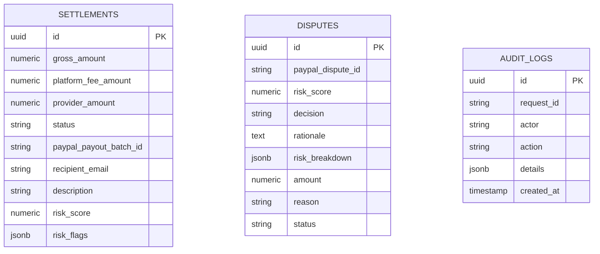

# SettlAgent — Architecture & Onboarding Guide

> Read this first. It explains what SettlAgent is, how it is built, where the AI sits in it, and how to use it step by step.
> All diagrams are Mermaid — they render on GitHub and in VS Code. For exportable images open `docs/architecture.html` in a browser.

---

## 1. What is SettlAgent?

SettlAgent is an **autonomous settlement and dispute-triage agent for marketplaces that pay out through PayPal.**

A marketplace (freelancers, gig workers, service providers) has two painful, repetitive money jobs:

1. **Settlement** — when a job is done, split the customer's payment into the platform's fee and the provider's share, and *actually pay the provider*.
2. **Disputes** — when a customer disputes a payment, someone has to read it, judge the risk, and either resolve it or escalate it.

SettlAgent does both automatically, **but keeps a human in charge of anything risky**. Every decision is written to an audit trail with the reason behind it.

---

## 2. System architecture





**Layering rule (backend):** Controller → Service → Repository → DTO. Controllers only parse/validate; services hold the business logic; repositories are the only code that touches the database or PayPal.

| Component | Tech | Responsibility |
|---|---|---|
| Web app | Next.js 16, React, MUI, TanStack Query | Landing page, login, 6-page operator console |
| Session gate | `proxy.ts` + signed httpOnly cookie | Blocks `/dashboard` and `/api/*` unless signed in |
| BFF routes | Next.js route handlers | Server-side bridge; attaches the internal bearer token so the browser never sees it |
| Agent API | FastAPI, SQLAlchemy async | All business logic and PayPal/LLM calls |
| Worker | Arq + Redis | Runs slow work (dispute triage) off the request path |
| Database | PostgreSQL 16 | Settlements, disputes, append-only audit log |
| PayPal | Sandbox: Payouts, Disputes, Webhooks | The real money movement |
| LLM | Gemini (hosted) or Ollama qwen3:8b (local) | Dispute risk reasoning |

---

## 3. The two flows, step by step

### 3.1 Settlement flow (with the Payment Guardian)



**Payment Guardian rules** (plain code over real data — no LLM, so it is fast, free, and explainable):

| Rule | Triggers when |
|---|---|
| `LARGE_AMOUNT` | Amount ≥ review threshold (`GUARDIAN_REVIEW_THRESHOLD`, default $500) |
| `AMOUNT_ANOMALY` | Amount > 3× the median of past payouts (needs ≥ 3 history rows) |
| `VELOCITY` | ≥ 3 payouts to the same recipient within 1 hour |
| `HIGH_FEE` | Platform fee > 30% of the amount |
| `NEW_RECIPIENT` | Recipient never paid before (only once a recipient book exists) |

Each rule adds a weight; the score is capped at 1.0 and a score ≥ 0.4 holds the payout.

### 3.2 Dispute flow (where the AI works)



No one clicks "triage" — the webhook starts it. (A **Simulate dispute** button on the console lets you demo this without waiting for PayPal.)

---

## 4. How AI plays a crucial role

**What the AI does.** The LLM is the *Dispute Investigation* brain. For each dispute it reads the raw PayPal payload and returns a **structured** verdict:

- an overall **risk score** (0–1),
- a **5-axis breakdown**: fraud, policy, chargeback, identity, merchant,
- a written **rationale** a human can read,
- a **recommended action**: auto-resolve or escalate.

This is judgment over messy, text-heavy data — exactly what fixed rules do poorly, and why an LLM is used here.

**What the AI is *not* allowed to do alone.** Safety is designed around the model, not trusted to it:

| Safeguard | How it works |
|---|---|
| Two-key auto-resolve | A dispute is auto-resolved **only if** the model says `auto_resolve` **and** the numeric score is below 0.3. Either one disagreeing → escalate. |
| Structured output | The model must fill a typed schema; free-form text cannot trigger an action. |
| Money is rule-based | The Payment Guardian uses deterministic rules, not the LLM — payouts are never decided by a language model. |
| Human in the loop | Held payouts and escalated disputes need an authenticated operator. |
| Full audit trail | Every decision stores actor, rationale, provider used, and whether it was simulated. |
| Quota protection | A token bucket (4 calls / 60 s) protects the hosted Gemini free tier; retries are bounded. |

**Vendor-agnostic.** One setting — `LLM_PROVIDER=gemini` or `ollama` in `.env` — swaps the hosted model for a fully local one. No code changes.

**Where each "agent" lives (honest map):**

| Named agent | Real implementation | Uses LLM? |
|---|---|---|
| Payment Guardian | `services/guardian.py` | No — rules over real history |
| Dispute Investigation | `services/dispute_service.py` | **Yes** |
| Human operator | Approval Queue + Disputes page | — |
| Audit / Replay | `audit_logs` table → Decision Replay & Activity pages | No |

---

## 5. Data model



Settlement statuses: `pending`, `awaiting_approval`, `rejected`, `paid_out`, `payout_failed`, `failed`. Dispute statuses: `auto_resolved`, `escalated`. Audit actors: `settlement_service`, `payment_guardian`, `human_operator`, `dispute_service`.

`audit_logs` is append-only: it feeds the Decision Replay, Agent Activity and Audit & Reports pages.

---

## 6. Security model

```mermaid
flowchart LR
  B[Browser] -- "signed httpOnly cookie" --> P[proxy.ts]
  P -- valid --> R[Next.js pages + /api/*]
  P -- "invalid page" --> LG[/login]
  P -- "invalid API call" --> E401[401 JSON]
  R -- "Bearer AGENT_INTERNAL_TOKEN<br/>server-side only" --> A[Agent API]
  PP[PayPal] -- "signed webhook" --> A
```

- Single admin account from `.env` (`ADMIN_USERNAME`, `ADMIN_PASSWORD`); constant-time compare; 5 attempts/min limit.
- Session = HMAC-SHA256 signed token (`SESSION_SECRET`), 8-hour life, httpOnly cookie.
- The agent API is reachable only with the internal token, which the browser never holds.
- PayPal webhooks are verified by signature (when `PAYPAL_WEBHOOK_ID` is set).
- Secrets live only in the gitignored root `.env`.

---

## 7. Using the application (operator walkthrough)

**Start it**
```bash
docker compose -f infra/docker-compose.yml up -d
```
Open **http://localhost:3000** → **Sign in to the console** → username `admin`, password = `ADMIN_PASSWORD` in `.env`.

**The six pages**

| Page | Use it to |
|---|---|
| Command Center | See KPIs, the live operations feed, and everything that needs a human |
| Settlements | Create a settlement, approve/reject held payouts, see the pipeline and ledger |
| Disputes | See triaged disputes with the risk radar; simulate a dispute |
| Decision Replay | Step through exactly why the agent decided what it did |
| Agent Activity | Filterable timeline of every action, by actor |
| Audit & Reports | Totals and the audit trail for review |

**Five-minute demo script**
1. Settlements → create **$25** to the sandbox recipient → auto-paid; note the PayPal batch ID.
2. Create **$900** → the Payment Guardian holds it → it appears in the **Approval Queue** with its rule hits.
3. Click **Approve & pay** → real sandbox payout; or **Reject** → never pays.
4. Disputes → **Simulate dispute** → the LLM scores it; low risk auto-resolves, high risk escalates with a rationale.
5. Decision Replay / Agent Activity → show the full explained trail.

---

## 8. Configuration (`.env`)

| Variable | Purpose |
|---|---|
| `PAYPAL_CLIENT_ID` / `PAYPAL_CLIENT_SECRET` | PayPal **sandbox** app credentials |
| `PAYPAL_ENVIRONMENT` | `SANDBOX` |
| `PAYPAL_WEBHOOK_ID` | Enables webhook signature verification |
| `LLM_PROVIDER` | `gemini` or `ollama` |
| `GEMINI_API_KEY` | Google AI Studio key |
| `OLLAMA_BASE_URL` / `OLLAMA_MODEL` | Local model endpoint |
| `AGENT_INTERNAL_TOKEN` | Shared secret between web BFF and agent API |
| `ADMIN_USERNAME` / `ADMIN_PASSWORD` / `SESSION_SECRET` | Console login |
| `GUARDIAN_REVIEW_THRESHOLD` | Dollar amount that forces human review (default 500) |
| `DATABASE_URL` / `REDIS_URL` | Infrastructure |

---

## 9. Known limits (honest)

- PayPal runs in **Sandbox** only — no real funds move.
- The Gemini free tier is rate-limited and can return 503 under load; switch to Ollama for resilience (slower).
- Disputes created by "Simulate" are synthetic payloads run through the real triage pipeline and are flagged `simulated` in the audit log.
- The Guardian's anomaly rules need payout history; on an empty database only the amount threshold and fee rules can fire.
- Single admin account — no roles or multi-user audit identity yet.

---

## 10. The motive of the application

**Marketplaces lose time and money on the least glamorous part of their business: paying people correctly and handling disputes fairly.** Both are repetitive, high-stakes, and usually done by hand — slow when volume grows, and dangerous when someone rushes.

SettlAgent's motive is to **let an AI agent do the repetitive 90% — and guarantee a human controls the risky 10%:**

- **Pay providers right and on time** — automatic split and real payouts, no spreadsheets.
- **Stop bad payouts before money moves** — a rule-based guardian that holds anomalies for approval.
- **Resolve disputes in seconds, not days** — the AI reads, scores and acts on clear cases, and escalates unclear ones with its reasoning attached.
- **Stay trustworthy** — every action is explained and auditable, so the AI is a transparent assistant, never a black box with a bank account.

In one line: **autonomy where it is safe, human judgment where it matters, and proof for every decision.**
